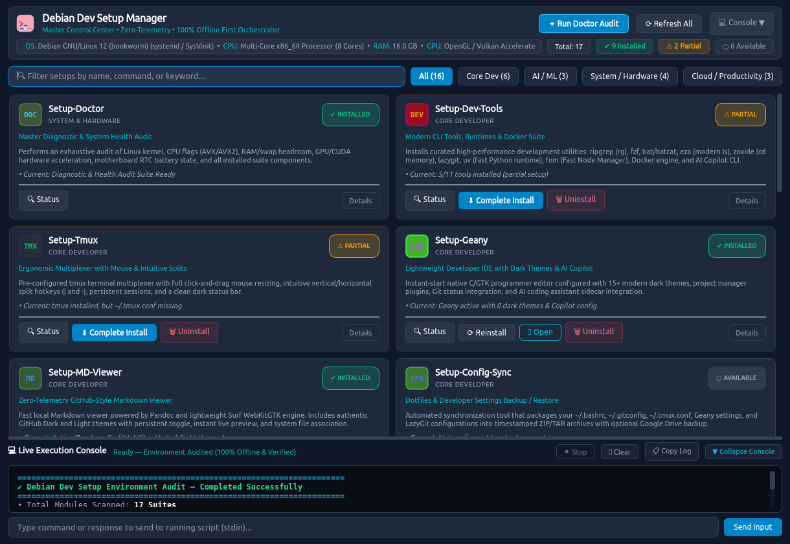
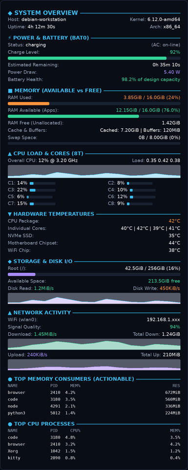

# Debian Dev Suite [](VERSION) [](LICENSE) [-emerald.svg?style=flat-square)](#) [](#)

> **Current Release:** `v1.0.0` • Single Source of Truth: [`VERSION`](VERSION)

A modular, **ultra-lightweight, 100% open-source, secure**, and **privacy-focused (0 telemetry)** developer environment toolkit for **Debian, MX Linux, antiX, Ubuntu, Linux Mint, Devuan**, and all Debian-derived distributions.

Designed to turn any machine—from ultra-resource-constrained legacy hardware (e.g., dual-core laptops with 2GB–3GB RAM) to modern multi-core workstations with dedicated GPUs—into a blisteringly fast, distraction-free development environment without the bloat of heavy desktop software.

```text
  🪶 Ultra-Lightweight (0–50MB RAM)  •  🔓 100% Open-Source (FOSS)  •  🛡️ Secure by Design  •  🔒 Privacy-Focused (0 Telemetry)
```

---

## 1-Click Visual Control Center & System Doctor

### 🖥️ Master GUI Manager (`Debian Dev Suite Manager (v1.0.0)`)
Launch the modern graphical control center to visually inspect all components, trigger 1-click installations or clean uninstalls, watch live shell commands stream in an embedded terminal, and inspect individual module diagnostics:



```bash
./manager.sh
```

### 🩺 System Doctor (CLI Health Audit)
Instantly audit your system's hardware, CPU vector instructions, RAM, GPU drivers, CMOS clock integrity, and installed suite modules:

```bash
chmod +x doctor.sh
./doctor.sh
```

---

## Table of Contents

- [1-Click Visual Control Center & System Doctor](#1-click-visual-control-center--system-doctor)
- [Core Pillars & Complete Tool Audit Table](#core-pillars--complete-tool-audit-table)
- [Hardware & Environment Matrix](#hardware--environment-matrix)
- [Complete Repository Directory Map](#complete-repository-directory-map)
- [Repository Modules (1 to 18)](#repository-modules-1-to-18)
  - [1. Setup-GUI-Manager (Master Visual Control Center & Orchestrator)](#1-setup-gui-manager-master-visual-control-center--orchestrator)
  - [2. Setup-LLAMA-CPP (Standard Workstations & Modern Systems)](#2-setup-llama-cpp-standard-workstations--modern-systems)
  - [3. Setup-LLAMA-CPP-LEGACY (Legacy & Low-Spec Computers)](#3-setup-llama-cpp-legacy-legacy--low-spec-computers)
  - [4. Setup-Dev-Tools (CLI, Git, Runtimes, Docker, Copilot)](#4-setup-dev-tools-cli-git-runtimes-docker-copilot)
  - [5. Setup-Doctor (System & Suite Diagnostic Tool)](#5-setup-doctor-system--suite-diagnostic-tool)
  - [6. Setup-Tmux (Ergonomic Terminal Multiplexer)](#6-setup-tmux-ergonomic-terminal-multiplexer)
  - [7. Setup-Config-Sync (Offline USB & GDrive Config Backup)](#7-setup-config-sync-offline-usb--gdrive-config-backup)
  - [8. Setup-GDrive (Google Drive Streaming Mount)](#8-setup-gdrive-google-drive-streaming-mount)
  - [9. Setup-Geany (Lightweight IDE & Editor)](#9-setup-geany-lightweight-ide--editor)
  - [10. Setup-MD-Viewer (WebKitGTK Markdown Previewer)](#10-setup-md-viewer-webkitgtk-markdown-previewer)
  - [11. Setup-Sync-Time (RTC & Network Time Synchronizer)](#11-setup-sync-time-rtc--network-time-synchronizer)
  - [12. Setup-Local-GitHub (Private Localhost Git Forge — Forgejo)](#12-setup-local-github-private-localhost-git-forge--forgejo)
  - [13. Setup-Virtual-Box (Secure Hardened VirtualBox with GUI)](#13-setup-virtual-box-secure-hardened-virtualbox-with-gui)
  - [14. Setup-Hinglish (100% Offline Hinglish to Hindi Typing)](#14-setup-hinglish-100-offline-hinglish-to-hindi-typing)
  - [15. Setup-Brightness (Standalone GUI Brightness & Color Controller)](#15-setup-brightness-standalone-gui-brightness--color-controller)
  - [16. Setup-Deep-Sleep (Linux Battery & S3 Deep Sleep Optimization)](#16-setup-deep-sleep-linux-battery--s3-deep-sleep-optimization)
  - [17. Setup-Libre-Chat (100% Offline AI Chat Web Interface)](#17-setup-libre-chat-100-offline-ai-chat-web-interface)
  - [18. Setup-Detailed-Conkey (Obsidian Dark Glass System Monitor & Diagnostics)](#18-setup-detailed-conkey-obsidian-dark-glass-system-monitor--diagnostics)
- [Quick Start Command Reference](#quick-start-command-reference)
- [Distribution Compatibility](#distribution-compatibility)
- [Design Principles](#design-principles)
- [Third-Party Components, Credits & Acknowledgments](#third-party-components-credits--acknowledgments)
- [License & Intellectual Property](#license--intellectual-property)

---

## Core Pillars & Complete Tool Audit Table

Every tool in this repository is strictly audited against our four non-negotiable principles:

| Module / Tool | Selected Technologies | License & FOSS Status | RAM / Resource Footprint | Security & Privacy (0 Telemetry) | Why It Is Useful (Advantage over Bloatware) |
|---|---|---|---|---|---|
| **Setup-GUI-Manager** | Python 3 + PySide6 (Official Qt6 LGPL) + POSIX Bash | **100% Open Source** (MIT / LGPL) | **~25 MB RAM** only while active. | **Absolute 0 Telemetry.** 100% offline localhost execution. | Unified visual dashboard to see what is installed, trigger 1-click individual installs/uninstalls, inspect module status, and watch live shell execution in embedded terminal console. |
| **System Doctor** (`doctor.sh`) | POSIX Bash + Linux `/proc` audit | **100% Open Source** (MIT) | **0 MB idle RAM.** Runs in milliseconds. | **Zero Telemetry.** 100% offline localhost execution. | Instant 1-click diagnostic audit of CPU, RAM, GPU, CMOS battery reset, and installed suite tools. |
| **Setup-LLAMA-CPP (Standard)** | `llama.cpp` (C/C++), CUDA, Vulkan, CPU | **100% Open Source** (MIT) | Native C/C++ (~20-50MB runtime overhead + model). | **Absolute 0 Telemetry.** 100% offline local inference; no prompts or tokens ever leave your machine. | Replaces cloud AI subscriptions with local 1.5B–8B models, terminal chat, browser Web UI, and OpenAI REST API. |
| **Setup-LLAMA-CPP-LEGACY** | `llama.cpp` (Safe SSE build flags) | **100% Open Source** (MIT) | Runs safely in **sub-4GB RAM** (e.g. 2GB–3GB) with swap. | **Zero Telemetry.** 100% offline local inference. | Prevents `Illegal Instruction` crashes on older CPUs lacking SSE4.2/AVX extensions (e.g. vintage dual-core PCs). |
| **CLI PowerTools** | `ripgrep`, `fzf`, `bat`, `eza`, `zoxide` | **100% Open Source** (MIT / Apache / EUPL) | **0 MB idle RAM.** Compiled native Rust & Go static binaries. | **Zero Telemetry.** Pure offline file inspection; zero network calls. | **10x faster than grep/find/cat.** Instant fuzzy finding, modern visual directory listings, and smart jumping (`z`). |
| **Git & LazyGit** | `lazygit`, clean diffs, sensible config | **100% Open Source** (MIT) | **~15 MB RAM** only while active. | **Zero Telemetry.** Reads local git repository status; no telemetry or accounts. | **Replaces 600MB+ Electron Git GUIs.** Keyboard staging of hunks/lines, interactive rebasing, and visual conflict resolution. |
| **Dev Runtimes** | **Python:** `uv`<br>**Node.js:** `fnm`<br>**C/C++:** `build-essential` | **100% Open Source** (Apache / GPLv3 / MIT) | Native Rust binaries. Instant execution. | **Zero Telemetry.** `uv` has offline caching; `fnm` has zero analytics. | **`uv` is 10–100x faster than pip.** `fnm` eliminates the 300ms shell startup lag caused by `nvm`. |
| **Containers** | Docker Engine CE / Podman + `lazydocker` | **100% Open Source** (Apache / MIT) | Native Linux daemon (~30-50MB RAM). | Isolated Linux cgroups & namespaces. Optional rootless daemon. | **No 2GB Electron Docker Desktop.** Complete terminal visual dashboard for containers, logs, and volumes. |
| **Local AI Copilot** | `ai` CLI tool (Bash + Python stdlib) | **100% Open Source** (MIT) | **0 MB extra RAM.** Wired to local `llama-server` on `127.0.0.1:8080`. | **Absolute 0 Telemetry.** 100% localhost; no cloud keys or network traffic. | Instant terminal Q&A, bash command generator (`ai -c`), and stdin log/code piping without sending code to cloud. |
| **Setup-Tmux** | `tmux` + ergonomic mouse/split config | **100% Open Source** (BSD / MIT) | **~3 MB RAM.** Ultra-lightweight multiplexer. | **Zero Telemetry.** Pure local terminal session manager. | Split terminal into visual panes, persistent background sessions, mouse scrolling, and Vim navigation. |
| **Setup-Config-Sync** | `backup-dev-configs.sh` (ZIP / GDrive) | **100% Open Source** (MIT) | **0 MB idle RAM.** Plain bash script. | **100% Private.** Saves to local archive or private Google Drive; zero cloud leaks. | 1-click backup and restore of `.bashrc`, `.gitconfig`, Geany themes, LazyGit, and tmux across multiple PCs. |
| **Setup-GDrive** | `rclone` + FUSE userspace filesystem | **100% Open Source** (MIT) | **20 MB–50 MB RAM** (vs 500MB+ for official clients). | Non-root userspace execution; direct HTTPS to Google API. | Streams files on-demand with local VFS caching without downloading your entire cloud storage. |
| **Setup-Geany** | Geany IDE + curated dark themes | **100% Open Source** (GPLv2) | **~30 MB idle RAM** (loads in <0.2s). | **Zero Telemetry.** Completely offline code editor. | High-speed IDE with embedded terminal, syntax highlighting, and custom compiler build hooks. |
| **Setup-MD-Viewer** | `pandoc` + `surf` (WebKitGTK engine) | **100% Open Source** (GPL / MIT) | **~30 MB RAM** during active preview. | **Zero Telemetry.** Local-first rendering. | GitHub-style Markdown rendering with code copy buttons, Mermaid diagrams, and Dark/Light toggle. |
| **Setup-Sync-Time** | `systemd-timesyncd`, HTTP Date, NTP | **100% Open Source** (MIT) | **0 MB idle RAM.** Standalone recovery tool. | Secure HTTPS timestamps; no third-party telemetry. | Eliminates the "Year 2008 Clock Reset" caused by dead CMOS batteries, restoring SSL and APT package updates. |
| **Setup-Local-GitHub** | Forgejo (Go binary / rootless Docker Compose) + SQLite WAL | **100% Open Source** (GPLv3 / MIT) | **~40–70 MB RAM** (vs 4GB+ GitLab). Zero external DB daemon needed. | **100% Private (0 Telemetry).** Strict `127.0.0.1` loopback binding (HTTP: 3000, SSH: 2222), offline mode enabled, Gravatar/external CDNs blocked, public registration disabled. | Complete private local GitHub alternative for air-gapped dev, zero LAN exposure, 1-command push-to-create repos, integrated issues & PRs. |
| **Setup-Virtual-Box** | Oracle VirtualBox GUI + POSIX Bash + Udev hardening | **Open Source Core (GPLv2)** + official Oracle distribution | Native C/C++ hypervisor; lightweight daemonless setup when idle. | **Hardened Security & Least Privilege.** Cryptographic SHA256 integrity verification, attack surface minimization (no proprietary Extension Pack / VRDP by default, masks `vboxweb-service`), 0660 udev device node hardening, SUID binary hardening (4750), root GUI launch guard. | Safe VM virtualization on Debian without exposing host network ports or running hypervisors as root. |
| **Setup-Hinglish** | IBus + GNU `m17n-db` (`hi-itrans`) + Lohit Devanagari + Noto Color Emoji | **100% Open Source** (LGPL / GPL / OFL) | **0 MB extra RAM** (native input daemon). | **100% Private (0 Telemetry).** 0 bytes network traffic, works in airplane mode, zero keylogging. | Instant phonetic Hinglish-to-Hindi typing (`namaste` → **नमस्ते**). Dedicated app launchers & per-window isolation protect VS Code & terminal (`Ctrl+Space` preserved). |
| **Setup-Brightness** | Python 3 + PySide6 (Qt6 LGPL) + `xrandr` + `brightnessctl` | **100% Open Source** (MIT) | **~15–20 MB RAM.** Native GUI/CLI. | **Absolute 0 Telemetry.** 100% offline localhost; zero network calls. Blackout-proof safe clamping ($\ge 10\%$). | Replaces heavy/missing display controllers with standalone dual hardware/software engine, multi-monitor sync, blue light filter warmth slider (3000K–6500K), tray wheel-scroll dimming, and session auto-restore. |
| **Setup-Deep-Sleep** | Kernel ACPI S3 + TLP power management + systemd/SysVinit drop-ins | **100% Open Source** (GPL-3.0 / MIT) | **0 MB idle RAM.** Pure kernel & daemon power tuning. | **Absolute 0 Telemetry.** 100% offline hardware power rules; zero analytics. | Forces true S3 Suspend-to-RAM (`mem_sleep_default=deep`), eliminating overnight battery drain (down to ~1-2% over 8 hours), with dual systemd/SysVinit support and swap safety audit. |
| **Setup-Libre-Chat** | LibreChat + MongoDB (Docker Compose or Native Node.js v20+) | **100% Open Source** (MIT) | **~80–150 MB RAM.** Standalone local web UI. | **100% Private (0 Telemetry).** Strict `127.0.0.1:3080` binding, 256-bit AES encryption keys, zero cloud tracking. | Replaces cloud AI subscriptions with a rich, self-hosted ChatGPT-style UI wired directly to local `llama.cpp` (`127.0.0.1:8080`), with message history, prompt branching, and full data sovereignty. |
| **Setup-Detailed-Conkey** | Conky 1.10+ (Lua) + Linux sysfs/procfs | **100% Open Source** (GPL-3.0) | **~20–25 MB RAM.** Desktop overlay. | **100% Offline (0 Telemetry).** Reads local kernel statistics only; zero network calls. | Tailored dark-glass desktop system monitor with precise RAM available vs free distinction, battery wattage & health diagnostics, 8-thread CPU load, and module-named thermal sensors. |

---

## Hardware & Environment Matrix

| System Profile | Target CPU | Target RAM | GPU / Acceleration | Recommended Modules |
|---|---|---|---|---|
| **Modern Workstation / Laptop** | Core i3/i5/i7/i9, AMD Ryzen | 4 GB – 16 GB+ | NVIDIA (CUDA), Vulkan, OpenBLAS | `doctor.sh`, `Setup-LLAMA-CPP`, `Setup-Dev-Tools`, `Setup-Doctor`, `Setup-Tmux`, `Setup-Config-Sync`, `Setup-GDrive`, `Setup-Geany`, `Setup-MD-Viewer`, `Setup-Local-GitHub`, `Setup-Virtual-Box`, `Setup-Hinglish`, `Setup-Brightness`, `Setup-Deep-Sleep`, `Setup-Libre-Chat`, `Setup-Detailed-Conkey` |
| **Lightweight Distro (MX Linux)** | 64-bit Dual/Quad-Core | 4 GB – 8 GB | NVIDIA (MX Driver Installer) / Vulkan | `doctor.sh`, `Setup-LLAMA-CPP`, `Setup-Dev-Tools`, `Setup-Doctor`, `Setup-Tmux`, `Setup-Config-Sync`, `Setup-GDrive`, `Setup-Geany`, `Setup-MD-Viewer`, `Setup-Sync-Time`, `Setup-Local-GitHub`, `Setup-Virtual-Box`, `Setup-Hinglish`, `Setup-Brightness`, `Setup-Deep-Sleep`, `Setup-Libre-Chat`, `Setup-Detailed-Conkey` |
| **Ultra-Low-Spec (antiX / Legacy)** | Vintage 64-bit Dual-Core (e.g. Core 2 Duo, Pentium Dual-Core) | 2 GB – 4 GB | None (Pure SSE CPU inference) | `doctor.sh`, `Setup-LLAMA-CPP-LEGACY`, `Setup-Dev-Tools` (CLI/Git), `Setup-Doctor`, `Setup-Tmux`, `Setup-Config-Sync`, `Setup-GDrive`, `Setup-Geany`, `Setup-MD-Viewer`, `Setup-Sync-Time`, `Setup-Local-GitHub`, `Setup-Hinglish`, `Setup-Brightness`, `Setup-Deep-Sleep`, `Setup-Detailed-Conkey` |

---

## Complete Repository Directory Map

```text
Debian-Dev-Suite/
├── VERSION                                  # Single source of truth version definition (v1.0.0)
├── manager.sh                               # 1-Click root launcher for Master GUI Manager
├── doctor.sh                                # 1-Click root launcher for system & suite diagnostics
├── README.md                                # Master repository documentation & audit table
│
├── Setup-GUI-Manager/                       # Master visual control center & setup orchestrator
│   ├── README.md                            # Comprehensive GUI guide, live console & CLI documentation
│   ├── setup-manager.py                     # Native PySide6 (Qt6) GUI application with live terminal
│   ├── setup-manager.sh                     # Modular lifecycle manager (--install, --status, --uninstall)
│   ├── debian-dev-manager.desktop           # System application menu entry
│   └── debian-dev-suite.svg                 # Scalable vector application icon
│
├── Setup-LLAMA-CPP/                         # Standard local LLM setup (4-8GB+ RAM, multi-core, CUDA, Vulkan, Web UI)
│   ├── README.md                            # Comprehensive architecture, model sizing & Web UI guide
│   ├── USAGE-LLAMA-CPP.md                   # Daily CLI workflows, systemd service & OpenAI API examples
│   └── setup-LLAMA.CPP.sh                   # Parallel multi-core installer with smart model selection
│
├── Setup-LLAMA-CPP-LEGACY/                  # Legacy local LLM setup (vintage CPUs without AVX/SSE4.2, sub-4GB RAM)
│   ├── README.md                            # Architecture, safe SSE compiler flags & benchmark guide
│   ├── USAGE-LLAMA-CPP.md                   # Command examples, low-memory mode & thread tuning
│   └── setup-LLAMA.CPP.sh                   # Single-threaded safe installer with automatic swap creation
│
├── Setup-Dev-Tools/                         # Unified developer productivity suite
│   ├── README.md                            # Master dev tools guide & core pillars audit
│   ├── setup-dev-tools.sh                   # Modular interactive installer (--cli, --git, --docker, etc.)
│   └── docs/                                # Dedicated deep-dive guides:
│       ├── 1-CLI-POWERTOOLS.md              # ripgrep, fzf, bat, eza, zoxide workflows
│       ├── 2-GIT-LAZYGIT.md                 # lazygit keyboard shortcuts & staging
│       ├── 3-DEV-RUNTIMES.md                # uv (Python), fnm (Node.js), C/C++ toolchain
│       ├── 4-DOCKER-CONTAINERS.md           # Docker Engine, non-root access & lazydocker TUI
│       └── 5-LOCAL-AI-COPILOT.md            # ai terminal helper wired to llama.cpp (0 telemetry)
│
├── Setup-Doctor/                            # System & suite diagnostic health-check engine
│   ├── README.md                            # Health audit guide & troubleshooting tips
│   └── doctor.sh                            # Master hardware, clock, and module inspector
│
├── Setup-Tmux/                              # Aesthetic terminal multiplexer
│   ├── README.md                            # Overview, hotkeys table & features
│   ├── USAGE-TMUX.md                        # Multi-pane developer layouts & workflows
│   ├── setup-tmux.sh                        # Installer & bash alias configuration
│   └── tmux.conf                            # Ergonomic config with mouse support & visual splits
│
├── Setup-Config-Sync/                       # Multi-PC dotfiles & settings backup/restore
│   ├── README.md                            # Local ZIP, offline USB & Google Drive sync guide
│   ├── USAGE-CONFIG-SYNC.md                 # Multi-PC migration walkthrough
│   └── backup-dev-configs.sh                # Backup & restore tool with safe .bak rollbacks
│
├── Setup-GDrive/                            # Google Drive streaming mount (Rclone + FUSE)
│   ├── README.md                            # Setup guide, performance flags & autostart configs
│   └── setup-GoogleDrive.sh                 # Interactive installer & helper script generator
│
├── Setup-Geany/                             # Fast lightweight IDE & code editor
│   ├── README.md                            # Configuration guide, dark themes & keybindings
│   └── setup-geany.sh                       # Automated installer & theme deployment
│
├── Setup-MD-Viewer/                         # Distraction-free GitHub Markdown viewer
│   ├── README.md                            # WebKitGTK viewer guide & file manager integration
│   └── setup-md-viewer.sh                   # Automated Pandoc + Surf installer
│
├── Setup-Local-GitHub/                      # Private localhost Git Forge (Forgejo, 127.0.0.1 binding)
│   ├── README.md                            # Complete architecture, workflow & push-to-create guide
│   ├── FORGEJO_LOCALHOST_SETUP.md           # Step-by-step setup walkthrough & systemd integration
│   ├── SECURITY_AUDIT.md                    # 12-point loopback & network isolation audit report
│   ├── docker-compose.yml                   # Optional rootless container deployment config
│   └── forgejo-localhost.sh                 # Turnkey lifecycle manager (install, audit, backup, user)
│
├── Setup-Virtual-Box/                       # Secure, hardened VirtualBox hypervisor with GUI
│   ├── README.md                            # Security pillars, udev hardening & least privilege guide
│   ├── setup_virtualbox_secure.sh           # Automated installer with SHA256 verification & hardening
│   └── test_suite.sh                        # Automated test suite for installation & validation flags
│
├── Setup-Hinglish/                          # 100% offline Hinglish-to-Hindi phonetic typing
│   ├── README.md                            # Complete phonetic cheatsheet, app launchers & isolation guide
│   ├── hinglish-to-hindi-typing.sh          # Automated installer with zero VS Code shortcut conflict
│   ├── easy-hindi-typing.sh                 # Standalone 100% offline localhost app launcher (EasyHindiTyping)
│   └── easy-hindi-typing/                   # Localhost web app (HTML5, Vanilla CSS, JS phonetic engine, 127.0.0.1:8765)
│
├── Setup-Brightness/                        # Standalone GUI brightness & night light controller
│   ├── README.md                            # Architecture, shortcuts, presets & security audit guide
│   ├── setup-brightness.sh                  # Turnkey installer, diagnostic status & unit test runner
│   ├── brightness-controller.py             # Standalone PySide6 (Qt6) GUI & CLI controller engine
│   ├── brightness-controller.desktop        # Desktop application menu launcher
│   ├── brightness-restore.desktop           # XDG autostart hook for persistent session restore
│   └── brightness-controller.svg            # Scalable vector application icon
│
├── Setup-Deep-Sleep/                         # Linux battery & S3 deep sleep optimization
│   ├── README.md                            # S3 vs Modern Standby, TLP tuning & swap audit guide
│   └── setup-deep-sleep.sh                  # Dual-init installer (systemd/SysVinit), status & GRUB config
│
├── Setup-Libre-Chat/                        # 100% offline, localhost isolated AI web interface
│   ├── README.md                            # Architecture, local llama.cpp integration & security audit
│   ├── setup-librechat.sh                   # Turnkey manager (Docker/Native, start/stop/status/logs)
│   ├── docker-compose.yml                   # Hardened localhost-only Docker Compose stack
│   ├── librechat.yaml                       # Pre-configured endpoints for local llama.cpp (127.0.0.1:8080)
│   └── .env.example                         # Sanitized configuration template for 256-bit secrets
│
├── Setup-Detailed-Conkey/                   # Obsidian dark-glass desktop system monitor
│   ├── README.md                            # Comprehensive sensor, RAM & power architecture guide
│   ├── Setup-Detailed-Conky.sh              # Single-file installer, daemon controller & diagnostic manager
│   ├── setup-detailed-conky.sh              # Compatibility symlink to Setup-Detailed-Conky.sh
│   └── conky.conf                           # Active Lua Conky desktop configuration
│
└── Setup-Sync-Time/                          # Network & offline clock recovery
    ├── README.md                            # RTC CMOS Year 2008 failure guide & fix breakdown
    └── sync-time.sh                         # Multi-stage hierarchy synchronizer
```

---

## Repository Modules (1 to 18)

### 1. [Setup-GUI-Manager](Setup-GUI-Manager/README.md) (Master Visual Control Center & Orchestrator)

A modern, high-performance native desktop GUI control center for Debian and MX Linux systems. It provides a visual dashboard to audit installed components, trigger one-click installs/uninstalls, view real-time terminal output, and check individual module diagnostics.

- **See What Is Installed**: Real-time asynchronous module detection with color-coded status pills (🟢 Installed, 🟡 Partial, ⚪ Available).
- **1-Click Install & Clean Uninstall**: Manage any component directly from the visual card grid with confirmation safety prompts.
- **Live Terminal Console**: Streams command stdout/stderr line-by-line with full ANSI color translation and an interactive stdin input field.
- **Individual Status Diagnostics**: Runs individual module `--status` commands on demand and streams detailed health audits.
- **Direct App Launchers**: One-click launchers for Geany, Markdown Viewer, LibreChat, Forgejo, Brightness Controller, and VirtualBox.

```bash
# Launch GUI Manager (Non-root)
./manager.sh

# Or manage desktop integration:
cd Setup-GUI-Manager && sudo ./setup-manager.sh --install    # Install desktop launcher & symlink
./Setup-GUI-Manager/setup-manager.sh --status              # Diagnostic status
sudo ./Setup-GUI-Manager/setup-manager.sh --uninstall      # Clean uninstallation
```

👉 **Documentation:** [Setup-GUI-Manager/README.md](Setup-GUI-Manager/README.md)

---

### 2. [Setup-LLAMA-CPP](Setup-LLAMA-CPP/README.md) (Standard Workstations & Modern Systems)

A production-grade, highly optimized local LLM runner powered by **llama.cpp** for systems with **4GB–8GB+ RAM** and standard modern multi-core processors.

- **100% Offline & 0 Telemetry:** Local inference without external servers or cloud accounts.
- **Acceleration Backends:** NVIDIA CUDA (`-DGGML_CUDA=ON`), universal Vulkan (`-DGGML_VULKAN=ON`), OpenBLAS (`-DGGML_BLAS=ON`), and Native CPU vectorization (`AVX2`, `AVX-512`).
- **Flexible Model Selection:** Choose between curated downloads (1.5B, 3B, 7B, 8B), linking existing `.gguf` files, or skipping downloads.
- **Launchers Generated:** `run-llama-cli` (interactive chat) and `run-llama-server` (Web UI & OpenAI API on `http://127.0.0.1:8080`).

```bash
# Quick Commands:
cd Setup-LLAMA-CPP && ./setup-LLAMA.CPP.sh --install    # Build & download model
./setup-LLAMA.CPP.sh --status                           # Check status & models
run-llama-cli                                           # Terminal chat (or run-llama-server)
./setup-LLAMA.CPP.sh --uninstall                        # Clean interactive uninstall
```

👉 **Documentation:** [Setup-LLAMA-CPP/README.md](Setup-LLAMA-CPP/README.md) | [Usage Guide](Setup-LLAMA-CPP/USAGE-LLAMA-CPP.md)

---

### 3. [Setup-LLAMA-CPP-LEGACY](Setup-LLAMA-CPP-LEGACY/README.md) (Legacy & Low-Spec Computers)

Custom-tailored llama.cpp environment specifically engineered for older, vintage, or resource-constrained computers lacking modern vector instruction sets (e.g., vintage 64-bit dual-core processors with 2GB–4GB RAM running lightweight Debian distributions like antiX, MX Linux, or minimal Debian).

- **Crash Prevention:** Explicit safe flags (`-mno-sse4.1 -mno-sse4.2 -mno-popcnt -DGGML_AVX=OFF`) prevent `Illegal Instruction` crashes on legacy CPUs without SSE4.2 support.
- **Single-Thread Compilation:** Constrained to `-j1` with automated swap setup to prevent compiler OOM crashes on systems with sub-4GB RAM.
- **Compact Model:** Configured for compact 0.5B models (Qwen2.5-0.5B ~398MB) operating smoothly within 2GB–4GB RAM.
- **Tested Reference Benchmark:** Verified and benchmarked on real vintage hardware (Intel Pentium Dual-Core T4300, 3GB RAM, antiX Linux) achieving ~1.5–2.5 tokens/sec.

```bash
# Quick Commands:
cd Setup-LLAMA-CPP-LEGACY && ./setup-LLAMA.CPP.sh --install  # Safe build for legacy CPUs
./setup-LLAMA.CPP.sh --status                                # Check status
./setup-LLAMA.CPP.sh --uninstall                             # Clean uninstallation
```

👉 **Documentation:** [Setup-LLAMA-CPP-LEGACY/README.md](Setup-LLAMA-CPP-LEGACY/README.md) | [Usage Guide](Setup-LLAMA-CPP-LEGACY/USAGE-LLAMA-CPP.md)

---

### 4. [Setup-Dev-Tools](Setup-Dev-Tools/README.md) (CLI, Git, Runtimes, Docker, Copilot)

A unified modular toolkit providing five essential developer capabilities without Electron bloat or cloud tracking:

1. **CLI PowerTools:** `ripgrep` (10x faster search), `fzf` (fuzzy finding), `bat` (syntax cat), `eza` (modern ls), and `zoxide` (smart directory jumping).
2. **Git & LazyGit TUI:** High-speed keyboard Git staging, interactive rebasing, clean diffs, and conflict resolution (~15MB RAM).
3. **Developer Runtimes:** `uv` (10–100x faster Python manager in Rust), `fnm` (Fast Node Manager in Rust), and full C/C++ toolchain (GCC, G++, Make, GDB, Valgrind).
4. **Lightweight Containers:** Docker Engine CE / Rootless Podman without Docker Desktop + `lazydocker` TUI.
5. **Local AI Copilot:** Standalone `ai` terminal assistant wired directly to your local `llama-server` on `127.0.0.1:8080` (0 telemetry).

```bash
# Quick Commands:
cd Setup-Dev-Tools && ./setup-dev-tools.sh --install    # Turnkey modular installation
./setup-dev-tools.sh --status                          # Diagnostic status of all 11 tools
./setup-dev-tools.sh --uninstall                       # Clean interactive removal
```

👉 **Documentation:** [Setup-Dev-Tools/README.md](Setup-Dev-Tools/README.md)  
📖 **How-to-Use Guides:**
- [1. CLI PowerTools Guide](Setup-Dev-Tools/docs/1-CLI-POWERTOOLS.md)
- [2. Git & LazyGit Guide](Setup-Dev-Tools/docs/2-GIT-LAZYGIT.md)
- [3. Developer Runtimes Guide](Setup-Dev-Tools/docs/3-DEV-RUNTIMES.md)
- [4. Containers & LazyDocker Guide](Setup-Dev-Tools/docs/4-DOCKER-CONTAINERS.md)
- [5. Local AI Copilot Guide](Setup-Dev-Tools/docs/5-LOCAL-AI-COPILOT.md)

---

### 5. [Setup-Doctor](Setup-Doctor/README.md) (System & Suite Diagnostic Tool)

A 1-click diagnostic health-check engine that audits hardware, vector math instruction sets, RAM/swap capacity, GPU acceleration, and CMOS battery clock status.

- **Year 2008 Detection:** Flags motherboard RTC battery resets that break SSL and APT.
- **Hardware Verification:** Tests AVX2/AVX-512, CUDA, and Vulkan readiness.
- **Module Inspection:** Scans all suite modules and provides color-coded status checks.
- **Non-Destructive & Read-Only:** Zero system alterations; purely diagnostic.

```bash
# Run Health Check:
chmod +x doctor.sh && ./doctor.sh
```

👉 **Documentation:** [Setup-Doctor/README.md](Setup-Doctor/README.md)

---

### 6. [Setup-Tmux](Setup-Tmux/README.md) (Ergonomic Terminal Multiplexer)

A production-grade, aesthetic **tmux** configuration for multi-tasking in the terminal in ~3MB RAM.

- **Mouse-Driven Control:** Click panes to focus, drag borders to resize, and scroll history with mouse wheel.
- **Intuitive Splits:** <kbd>Ctrl+B</kbd> then <kbd>\|</kbd> (vertical) and <kbd>Ctrl+B</kbd> then <kbd>-</kbd> (horizontal).
- **Persistent Sessions:** Programs keep running in the background when detached. Launch with `tm`.

```bash
# Quick Commands:
cd Setup-Tmux && ./setup-tmux.sh --install      # Install tmux, shortcuts & ~/.tmux.conf
./setup-tmux.sh --status                        # Status check
tm                                              # Launch persistent terminal session
./setup-tmux.sh --uninstall                     # Revert ~/.tmux.conf and remove aliases
```

👉 **Documentation:** [Setup-Tmux/README.md](Setup-Tmux/README.md) | [Usage & Multi-Pane Layouts Guide](Setup-Tmux/USAGE-TMUX.md)

---

### 7. [Setup-Config-Sync](Setup-Config-Sync/README.md) (Offline USB & GDrive Config Backup)

A 1-click backup and synchronization tool that archives your `.bashrc`, `.gitconfig`, Geany themes, LazyGit, and tmux settings.

- **Offline USB Workflow:** Always creates local ZIP and TAR.GZ archives in `~/Debian-Dev-Backups/` with ready-to-use copy instructions for flash drives.
- **Automatic Google Drive Sync:** Syncs directly to `~/GoogleDrive/Debian-Dev-Backups/` if Google Drive is mounted.
- **Hardened Permissions & Safe Restores:** Uses secure temporary staging directories (`mktemp -d` mode `0700`), locks archives to `0600` to prevent token leakage, and automatically creates a timestamped safety backup (`.bak`) before restoring configurations.

```bash
# Quick Commands:
cd Setup-Config-Sync && ./backup-dev-configs.sh --install  # Register shortcuts in ~/.bashrc
./backup-dev-configs.sh --status                          # Audit backups & tracked files
backup-configs                                            # Create backup (Local + GDrive)
./backup-dev-configs.sh --uninstall                       # Remove shortcuts & cleanup
```

👉 **Documentation:** [Setup-Config-Sync/README.md](Setup-Config-Sync/README.md) | [Multi-PC Walkthrough Guide](Setup-Config-Sync/USAGE-CONFIG-SYNC.md)

---

### 8. [Setup-GDrive](Setup-GDrive/README.md) (Google Drive Streaming Mount)

A seamless, on-demand cloud storage mount for Google Drive using **Rclone** and **FUSE (Filesystem in Userspace)**.

- **Ultra-Lightweight:** Consumes just **20 MB–50 MB of RAM** (compared to 500MB+ for official Electron clients).
- **VFS Full Caching:** Files stream on-demand when opened; does not waste disk space by downloading your entire Google Drive.
- **File Manager Integration:** Mounts directly as a local folder (`~/GoogleDrive`) accessible via Thunar, PCManFM, SpaceFM, or terminal.

```bash
# Quick Commands:
cd Setup-GDrive && ./setup-GoogleDrive.sh --install        # Turnkey rclone + FUSE mount setup
./setup-GoogleDrive.sh --status                           # Check mount & service health
~/GoogleDrive-Bin/mount-gdrive                            # Manual mount (or auto-service)
./setup-GoogleDrive.sh --uninstall                        # Unmount & clean removal
```

👉 **Documentation:** [Setup-GDrive/README.md](Setup-GDrive/README.md)

---

### 9. [Setup-Geany](Setup-Geany/README.md) (Lightweight IDE & Editor)

Transform **Geany** into a modern, aesthetic development environment tailored for C/C++, Python, Rust, Bash, and Web development.

- **Instant Startup:** Loads in under 0.2 seconds and runs at ~30MB idle RAM (versus 800MB+ for VSCode).
- **100% Offline & Private:** No telemetry, no background phone-home analytics, and no mandatory cloud accounts.
- **Curated Dark Themes:** Includes high-contrast dark themes (Monokai, Bespin, Solarized Dark).

```bash
# Quick Commands:
cd Setup-Geany && ./setup-geany.sh --install              # Install Geany + dark themes
./setup-geany.sh --status                                 # Verify installation
geany &                                                   # Launch Geany
./setup-geany.sh --uninstall                              # Clean removal & prompt for packages
```

👉 **Documentation:** [Setup-Geany/README.md](Setup-Geany/README.md)

---

### 10. [Setup-MD-Viewer](Setup-MD-Viewer/README.md) (WebKitGTK Markdown Previewer)

An ultra-lightweight, local-first GitHub-style Markdown viewer powered by **Pandoc** and **Surf (WebKitGTK)**.

- **0 Telemetry & Local Execution:** Renders local Markdown files completely offline without transmitting content anywhere.
- **Crash-Proof Rendering:** Bypasses WebKitGTK bubblewrap sandboxing issues on older GPUs.
- **Rich Features:** Pinned high-contrast copy buttons on all code blocks, Dark/Light mode toggle (<kbd>T</kbd>), full width expansion (<kbd>W</kbd>), and Mermaid diagram rendering.

```bash
# Quick Commands:
cd Setup-MD-Viewer && ./setup-md-viewer.sh --install      # Install pandoc, surf & md-viewer
./setup-md-viewer.sh --status                             # Check rendering dependencies
md-viewer README.md                                       # Preview local markdown
sudo ./setup-md-viewer.sh --uninstall                     # Clean removal
```

👉 **Documentation:** [Setup-MD-Viewer/README.md](Setup-MD-Viewer/README.md)

---

### 11. [Setup-Sync-Time](Setup-Sync-Time/README.md) (RTC & Network Time Synchronizer)

A resilient time synchronization engine designed to resolve the notorious **"Year 2008 Clock Reset"** problem caused by dead motherboard CMOS batteries.

- **Breaks the "Catch-22":** Fetches real-time timestamps via HTTP headers, NTP, or manual prompts when APT is broken.
- **Multi-Stage Hierarchy:** Tries `systemd-timesyncd`, `chrony`, HTTP Date headers, and NTP servers.
- **Offline Mode:** Allows instant manual date/time entry without an internet connection.

```bash
# Quick Commands:
cd Setup-Sync-Time && sudo ./sync-time.sh                       # Sync clock via NTP/HTTP Date headers
sync-time --status                                             # Verify RTC & system clock health
sudo ./sync-time.sh --uninstall                                # Remove sync service & symlinks
```

👉 **Documentation:** [Setup-Sync-Time/README.md](Setup-Sync-Time/README.md)

---

### 12. [Setup-Local-GitHub](Setup-Local-GitHub/README.md) (Private Localhost Git Forge — Forgejo)

A production-ready, completely private, and strictly hardened **GitHub alternative running entirely on `localhost` (127.0.0.1)** using **Forgejo** (lightweight community fork of Gitea).

- **Strict 127.0.0.1 Binding:** Both Web HTTP (`127.0.0.1:3000`) and Git SSH (`127.0.0.1:2222`) bind exclusively to loopback, blocking LAN/Wi-Fi scans.
- **Zero Cloud & Zero Telemetry:** `OFFLINE_MODE = true`, Gravatar disabled, external CDNs blocked, and public registration disabled.
- **Push-to-Create:** Provision new remote repositories instantly with `git push -u origin main` without opening a browser.
- **Turnkey CLI:** Automated installation, status monitoring, automated security audit, backup/restore, user management, and service management via `./forgejo-localhost.sh`.

```bash
# Quick Commands:
cd Setup-Local-GitHub && ./forgejo-localhost.sh install    # Turnkey Forgejo on 127.0.0.1
./forgejo-localhost.sh status                             # Health audit & service check
./forgejo-localhost.sh start                              # Start background service
./forgejo-localhost.sh stop                               # Stop service
./forgejo-localhost.sh uninstall                          # Clean uninstallation
```

👉 **Documentation:** [Setup-Local-GitHub/README.md](Setup-Local-GitHub/README.md) | [Comprehensive Walkthrough](Setup-Local-GitHub/FORGEJO_LOCALHOST_SETUP.md) | [Security Audit Report](Setup-Local-GitHub/SECURITY_AUDIT.md)

---

### 13. [Setup-Virtual-Box](Setup-Virtual-Box/README.md) (Secure Hardened VirtualBox with GUI)

Automated, security-hardened installation of **Oracle VirtualBox with full GUI desktop integration**, implementing cryptographic package verification, attack surface minimization, and least-privilege host permissions.

- **Cryptographic SHA256 Verification:** Verifies official SHA256 hashes directly against Oracle HTTPS distribution servers before execution; fails safe on mismatch.
- **Attack Surface Minimization:** Excludes closed-source Extension Pack by default (eliminating VRDP remote desktop network listening and proprietary USB/webcam attack vectors) and masks unnecessary background services (`vboxweb-service` port 18083, `vboxballoonctrl`, `vboxautostart`).
- **Principle of Least Privilege:** Strictly restricts device node permissions (`/dev/vboxdrv*` to `0660 root:vboxusers`), hardens SUID helper binaries (`4750`), protects VM storage (`~/.config/VirtualBox` and `~/VirtualBox VMs` with `0700`), and blocks root GUI execution.
- **Automated Validation:** Includes full test suite (`test_suite.sh`) validating CLI options, checksum verification, dry-run simulations, and error paths.

```bash
# Quick Commands:
cd Setup-Virtual-Box && sudo ./setup_virtualbox_secure.sh          # Hardened installation
sudo ./setup_virtualbox_secure.sh --status                         # Status & drivers audit
VirtualBox &                                                      # Launch GUI
sudo ./setup_virtualbox_secure.sh --uninstall                      # Clean uninstallation (add --purge for VMs)
```

👉 **Documentation:** [Setup-Virtual-Box/README.md](Setup-Virtual-Box/README.md)

---

### 14. [Setup-Hinglish](Setup-Hinglish/README.md) (100% Offline Hinglish to Hindi Typing)

A turnkey, private, and fully automated phonetic Hindi typing system for Linux desktop environments (GNOME, KDE, XFCE, Fluxbox, antiX, MX Linux, Wayland & X11). Type phonetically in standard English (`namaste`, `kya haal hai`) and get real-time Devanagari transliteration (**नमस्ते**, **क्या हाल है**).

- **Easy Hindi Typing Localhost App:** Built-in standalone web application (like [easyhindityping.com](https://www.easyhindityping.com/)) running 100% offline on `http://127.0.0.1:8765`. Features real-time floating candidate suggestions (`1`–`9` keys, `Space`/`Enter` selection), 1-click clipboard copy, `.txt` download, quick Hindi symbols (`।`, `॥`, `ॐ`, `₹`), and virtual keyboard. Works universally across all window managers (Fluxbox, antiX, MX Linux).
- **100% Offline & Zero Telemetry:** 0 bytes network traffic, works in airplane mode with zero keylogging and zero external CDN scripts.
- **Zero VS Code / IDE Conflict:** Preserves `Ctrl + Space` exclusively for code auto-completion. Uses `Super + Space` (Win + Space) for dynamic toggling.
- **Dedicated App Launchers:** Includes 1-click launchers ("FeatherPad Hindi Notepad" & LibreOffice) to type Hindi without modifying global system keyboards.
- **Per-Window Isolation:** Hindi input is strictly confined to the active window—your code editor and terminal always remain in clean English.
- **Devanagari & Emoji Fonts:** Automatically installs Lohit Devanagari and Noto Color Emoji (`fonts-noto-color-emoji`).

```bash
# Quick Commands:
cd Setup-Hinglish && ./hinglish-to-hindi-typing.sh                 # Full IBus/m17n setup
./easy-hindi-typing.sh start                                      # Launch offline localhost app
./hinglish-to-hindi-typing.sh --check                              # Diagnostic status
./hinglish-to-hindi-typing.sh --uninstall                          # Revert system configurations
./easy-hindi-typing.sh --uninstall                                # Remove web app launcher
```

👉 **Documentation:** [Setup-Hinglish/README.md](Setup-Hinglish/README.md)

---

### 15. [Setup-Brightness](Setup-Brightness/README.md) (Standalone GUI Brightness & Color Controller)

An ultra-lightweight, 100% open-source, and privacy-respecting display brightness and night light controller for Debian and Linux desktop environments.

- **Dual Hardware/Software Engine:** Controls physical laptop LED backlights via `brightnessctl`/sysfs (saving battery power) AND controls universal software gamma via `xrandr` (dimming external HDMI/DisplayPort/DVI monitors and laptop screens from 10% to 150%).
- **Night Light & Blue Light Filter:** Smooth color temperature warmth slider (6500K daylight down to 3000K amber) to reduce eye fatigue during late-night development sessions.
- **Multi-Monitor Sync & Quick Presets:** Per-display independent controls or synchronized multi-monitor dimming, along with 5 instant 1-click presets (Daylight, Office, Evening, Night, Ultra-Dim).
- **System Tray & Hotkey Friendly:** Features a background system tray icon with mouse scroll-wheel dimming, plus a CLI tool (`brightness-control`) for easy Fn-key and window manager bindings.
- **Blackout-Proof & Zero Telemetry:** Clamps brightness to $\ge 10\%$ to prevent accidental screen lockouts, enforces strict regex input sanitization, and contains 0 network requests.

```bash
# Quick Commands:
cd Setup-Brightness && ./setup-brightness.sh --install            # Install hardware & gamma controls
./setup-brightness.sh --status                                    # Check backlight & display outputs
brightness-controller --gui &                                     # Launch graphical control panel
./setup-brightness.sh --uninstall                                 # Clean removal
```

👉 **Documentation:** [Setup-Brightness/README.md](Setup-Brightness/README.md)

---

### 16. [Setup-Deep-Sleep](Setup-Deep-Sleep/README.md) (Linux Battery & S3 Deep Sleep Optimization)

A turnkey, privacy-focused power optimization module that stops overnight laptop battery drain by forcing kernel Suspend-to-RAM (S3).

- **Forces True S3 Deep Sleep:** Modifies `/etc/default/grub` with `mem_sleep_default=deep` and regenerates the bootloader, preventing laptops from remaining in power-hungry modern standby (`s2idle`).
- **TLP Power Management:** Installs and enables `tlp` and `tlp-rdw` with zero telemetry, managing CPU governors, PCIe ASPM, and USB autosuspend.
- **Dual Init System Support:** Fully supports both `systemd` (via `/etc/systemd/sleep.conf.d/10-deep-sleep.conf` drop-ins) and `SysVinit` / MX Linux / antiX init systems.
- **Suspend-then-Hibernate with Swap Audit:** Automates 120-minute transition from RAM sleep to disk hibernation, with built-in swap size verification to prevent data loss.

```bash
# Quick Commands:
cd Setup-Deep-Sleep && sudo ./setup-deep-sleep.sh --install       # Enforce S3 deep sleep & TLP
./setup-deep-sleep.sh --status                                    # Non-root sleep & battery audit
sudo ./setup-deep-sleep.sh --uninstall                            # Clean revert of GRUB & sleep configs
```

👉 **Documentation:** [Setup-Deep-Sleep/README.md](Setup-Deep-Sleep/README.md)

---

### 17. [Setup-Libre-Chat](Setup-Libre-Chat/README.md) (100% Offline AI Chat Web Interface)

A turnkey, self-hosted, and zero-telemetry web interface for local AI models, pre-configured to stream directly from our local `llama.cpp` server (`http://127.0.0.1:8080/v1`).

- **100% Offline Data Sovereignty:** Replaces cloud ChatGPT/Claude with a self-hosted UI. Conversations, prompts, and tokens never leave your physical machine.
- **Zero Telemetry & 127.0.0.1 Isolation:** Strict loopback binding (`127.0.0.1:3080`). All telemetry, balance checks, and social trackers disabled.
- **Dual Mode Deployment:** Automated isolated Docker Compose stack (LibreChat + MongoDB on internal container network `librechat_net` with 0 host database port exposure) OR native Node.js v20+ execution for low-resource environments.
- **Cryptographic Security:** 256-bit AES `CREDS_KEY`, `CREDS_IV`, and JWT authentication secrets auto-generated with `0600` file permissions.

```bash
# Quick Commands:
cd Setup-Libre-Chat && ./setup-librechat.sh --install             # Turnkey Docker / Node.js setup
./setup-librechat.sh --status                                     # Verify web & MongoDB status
./setup-librechat.sh --start                                      # Start background service
./setup-librechat.sh --stop                                       # Stop background service
./setup-librechat.sh --uninstall                                  # Clean removal
```

👉 **Documentation:** [Setup-Libre-Chat/README.md](Setup-Libre-Chat/README.md)

---

### 18. [Setup-Detailed-Conkey](Setup-Detailed-Conkey/README.md) (Obsidian Dark Glass System Monitor & Diagnostics)



A tailored, privacy-first, and ultra-low-footprint Conky system monitor designed to provide desktop workstations and laptops with real-time hardware diagnostics and actionable insights.

- **Crucial RAM Distinction (Available vs. Free):** Explicitly separates usable Available RAM (reclaimable cache & buffers available to user applications) from raw Free RAM, with real-time percentage gauges to help you manage memory without triggering swap thrashing.
- **Battery Wattage & Health Diagnostics:** Live power consumption (W) calculated without kernel warnings, dynamic charge state, countdown timer, and health capacity retention comparison (charge_full / charge_full_design * 100).
- **Multi-Thread CPU & Named Thermals:** Dynamic core gauges for all logical threads (e.g. `C1`–`C8`) alongside driver-named thermal sensors (`coretemp`, `nvme`, `pch_cannonlake`, `ath10k_hwmon`) that never swap indices across reboots.
- **Full Vertical Scaling & Zoom:** Supports `--zoom [normal|large|xlarge]` to scale typography, gauges, and window height to take full vertical 1080p screen space (385px × 1020px) or 1440p/4K high-DPI displays.
- **Actionable Process Management:** Clean tabular display of top memory-consuming processes (with PID and Resident Memory) and CPU-intensive apps for rapid process termination.
- **Dual Autostart & Lifecycle Management:** Supports universal XDG desktop autostart (`~/.config/autostart/`) and MX Linux compatibility hooks (`~/.conky/conky-startup.sh`) via a single self-contained script.

```bash
# Quick Commands:
cd Setup-Detailed-Conkey && ./Setup-Detailed-Conky.sh --install   # Install & start Conky monitor
./Setup-Detailed-Conky.sh --status                                # Check daemon & metrics
./Setup-Detailed-Conky.sh --zoom large                            # Switch zoom mode (normal/large/xlarge)
./Setup-Detailed-Conky.sh --uninstall                             # Stop & clean autostart removal
```

👉 **Documentation:** [Setup-Detailed-Conkey/README.md](Setup-Detailed-Conkey/README.md)

---

## Quick Start Command Reference

| Module | Quick Install Command | Clean Uninstall Command | Verification / Usage | Key Advantage |
|---|---|---|---|---|
| **Setup-GUI-Manager** | `cd Setup-GUI-Manager && sudo ./setup-manager.sh --install` | `cd Setup-GUI-Manager && sudo ./setup-manager.sh --uninstall` | `./manager.sh` or `debian-dev-manager` | Visual control center, live terminal streaming & 1-click installer |
| **System Doctor** | `chmod +x doctor.sh && ./doctor.sh` | *(Read-only diagnostic scanner; no system alterations)* | `./doctor.sh` | 1-Click diagnostic health check |
| **Setup-LLAMA-CPP (Standard)** | `cd Setup-LLAMA-CPP && ./setup-LLAMA.CPP.sh --install` | `cd Setup-LLAMA-CPP && ./setup-LLAMA.CPP.sh --uninstall` | `run-llama-cli` or `run-llama-server` | 0 Telemetry Local AI (CUDA/Vulkan/CPU) |
| **Setup-LLAMA-CPP-LEGACY** | `cd Setup-LLAMA-CPP-LEGACY && ./setup-LLAMA.CPP.sh --install` | `cd Setup-LLAMA-CPP-LEGACY && ./setup-LLAMA.CPP.sh --uninstall` | `~/llama.cpp/build/bin/llama-cli -m <model>` | SSE-safe, runs on sub-4GB RAM |
| **Setup-Dev-Tools** | `cd Setup-Dev-Tools && ./setup-dev-tools.sh --install` | `cd Setup-Dev-Tools && ./setup-dev-tools.sh --uninstall` | `rg`, `fzf`, `lg`, `uv`, `lz`, `ai` | 5 modular dev tools in one script |
| **Setup-Doctor** | `cd Setup-Doctor && ./doctor.sh` | *(Read-only diagnostic engine; no system alterations)* | `./doctor.sh` | Hardware & module diagnostic engine |
| **Setup-Tmux** | `cd Setup-Tmux && ./setup-tmux.sh --install` | `cd Setup-Tmux && ./setup-tmux.sh --uninstall` | `tm` | Mouse-driven persistent terminal splits |
| **Setup-Config-Sync** | `cd Setup-Config-Sync && ./backup-dev-configs.sh --install` | `cd Setup-Config-Sync && ./backup-dev-configs.sh --uninstall` | `backup-configs` or `restore-configs` | Offline USB & GDrive dotfile sync |
| **Setup-GDrive** | `cd Setup-GDrive && ./setup-GoogleDrive.sh --install` | `cd Setup-GDrive && ./setup-GoogleDrive.sh --uninstall` | `~/GoogleDrive-Bin/mount-gdrive` | On-demand streaming (20MB RAM) |
| **Setup-Geany** | `cd Setup-Geany && ./setup-geany.sh --install` | `cd Setup-Geany && ./setup-geany.sh --uninstall` | Launch Geany from menu or `geany` | 30MB RAM, zero telemetry IDE |
| **Setup-MD-Viewer** | `cd Setup-MD-Viewer && ./setup-md-viewer.sh --install` | `cd Setup-MD-Viewer && sudo ./setup-md-viewer.sh --uninstall` | `md-viewer README.md` | Local WebKitGTK previewer |
| **Setup-Sync-Time** | `cd Setup-Sync-Time && sudo ./sync-time.sh` | `cd Setup-Sync-Time && sudo ./sync-time.sh --uninstall` | `sync-time --status` | Fixes CMOS Year 2008 clock failure |
| **Setup-Local-GitHub** | `cd Setup-Local-GitHub && ./forgejo-localhost.sh install` | `cd Setup-Local-GitHub && ./forgejo-localhost.sh uninstall` | `./forgejo-localhost.sh status` or `audit` | Private GitHub on 127.0.0.1 (0 LAN exposure) |
| **Setup-Virtual-Box** | `cd Setup-Virtual-Box && sudo ./setup_virtualbox_secure.sh` | `cd Setup-Virtual-Box && sudo ./setup_virtualbox_secure.sh --uninstall` | `VirtualBox &` or `./test_suite.sh` | SHA256 verified, least-privilege hardened VM hypervisor |
| **Setup-Hinglish** | `cd Setup-Hinglish && ./hinglish-to-hindi-typing.sh` | `cd Setup-Hinglish && ./hinglish-to-hindi-typing.sh --uninstall` | `./hinglish-to-hindi-typing.sh --web` or `./easy-hindi-typing.sh` | 100% offline phonetic Hindi typing + Localhost App (`namaste` → नमस्ते) |
| **Setup-Brightness** | `cd Setup-Brightness && ./setup-brightness.sh --install` | `cd Setup-Brightness && ./setup-brightness.sh --uninstall` | `brightness-controller --gui` or `brightness-control --set 75` | Standalone GUI + CLI, dual HW/SW dimming, blue light warmth |
| **Setup-Deep-Sleep** | `cd Setup-Deep-Sleep && sudo ./setup-deep-sleep.sh --install` | `cd Setup-Deep-Sleep && sudo ./setup-deep-sleep.sh --uninstall` | `./setup-deep-sleep.sh --status` | Stops overnight battery drain via kernel S3 deep sleep |
| **Setup-Libre-Chat** | `cd Setup-Libre-Chat && ./setup-librechat.sh --install` | `cd Setup-Libre-Chat && ./setup-librechat.sh --uninstall` | `librechat-localhost --start` or `http://127.0.0.1:3080` | Localhost ChatGPT UI connected to local llama.cpp |
| **Setup-Detailed-Conkey** | `cd Setup-Detailed-Conkey && ./Setup-Detailed-Conky.sh --install` | `cd Setup-Detailed-Conkey && ./Setup-Detailed-Conky.sh --uninstall` | `./Setup-Detailed-Conky.sh --zoom large` | Obsidian dark-glass desktop monitor, full-height zoom, RAM available vs free, battery wattage/health |

---

## Distribution Compatibility

All scripts are written in standard POSIX/Bash with distribution detection:

- **Debian GNU/Linux:** 11 (Bullseye), 12 (Bookworm), and Sid (Unstable)
- **MX Linux:** 21 (Wildflower), 23 (Libretto) — full support for SysVinit & systemd
- **antiX Linux:** 21, 22, 23 (SysVinit & Runit lightweight bases)
- **Ubuntu & Derivatives:** 20.04 LTS, 22.04 LTS, 24.04 LTS, Linux Mint, Pop!_OS
- **Devuan GNU+Linux:** Daedalus, Chimaera (systemd-free Debian)
- **Raspberry Pi OS:** 32-bit and 64-bit ARM architectures

---

## Design Principles

1. **Lightweight & Resource Respect:** Native compiled binaries (C/C++, Go, Rust) and lean GUI toolkits. Sub-50MB RAM footprints. Zero Electron bloat.
2. **100% Free & Open Source (FOSS):** Transparent, auditable code. No closed-source dependencies or subscription traps.
3. **Security by Default:** Non-root execution where possible, userspace FUSE mounts, sandbox-aware previewing, and explicit file permissions.
4. **Privacy-Focused (0 Telemetry):** No analytics, no phone-home telemetry, no user tracking. Everything executes locally and offline-first.
5. **Idempotent & Clean Exit:** Scripts can be run repeatedly without breaking existing settings. Interactive uninstallation provides safe, non-destructive cleanups.

---

## Third-Party Components, Credits & Acknowledgments

Debian Dev Suite is built upon the extraordinary contributions of the global open-source community. **We do not claim authorship, creation, or ownership of any third-party tools used in this suite.** This repository acts solely as an orchestrator, automator, and configuration framework that makes these exceptional tools turnkey, secure, and privacy-respecting on Debian and Linux environments.

All third-party tools, compilers, runtimes, daemons, and fonts remain the intellectual property and copyright of their respective authors and upstream projects:

| Component | Upstream Author / Project | Upstream Project URL | Official License | Role in Debian Dev Suite |
|---|---|---|---|---|
| **llama.cpp** | Georgi Gerganov & Contributors | [github.com/ggerganov/llama.cpp](https://github.com/ggerganov/llama.cpp) | MIT License | Local high-performance LLM inference engine (CUDA, Vulkan, OpenBLAS, CPU SIMD). Configured and wrapped by `Setup-LLAMA-CPP`. |
| **Forgejo** | Codeberg e.V. & Forgejo Contributors | [forgejo.org](https://forgejo.org) | GPL-3.0-or-later | Lightweight, self-hosted Git forge. Hardened and configured for 100% loopback (`127.0.0.1`) isolation by `Setup-Local-GitHub`. |
| **LibreChat** | Danny Avila & LibreChat Contributors | [github.com/LibreChat-AI/LibreChat](https://github.com/LibreChat-AI/LibreChat) | MIT License | Modern self-hosted AI chat web UI. Configured with zero-telemetry flags and pre-wired to `llama-server` by `Setup-Libre-Chat`. |
| **MongoDB** | MongoDB, Inc. | [mongodb.com](https://www.mongodb.com) | SSPL | Document database utilized by LibreChat for local conversation state and presets. |
| **TLP** | Thomas Koch (`linrunner`) & Contributors | [github.com/linrunner/TLP](https://github.com/linrunner/TLP) | GPL-3.0-or-later | Advanced Linux power management and battery optimization daemon. Automated and tuned by `Setup-Deep-Sleep`. |
| **Oracle VM VirtualBox** | Oracle Corporation | [virtualbox.org](https://www.virtualbox.org) | GPL-2.0 (Base Platform) | Desktop virtualization hypervisor. Security-hardened (least-privilege udev, SUID, and SHA256 verified) by `Setup-Virtual-Box`. |
| **ripgrep (`rg`)** | Andrew Gallant (`BurntSushi`) | [github.com/BurntSushi/ripgrep](https://github.com/BurntSushi/ripgrep) | MIT / Unlicense | Ultra-fast recursive line-oriented regex search tool. Installed by `Setup-Dev-Tools`. |
| **fzf** | Junegunn Choi (`junegunn`) | [github.com/junegunn/fzf](https://github.com/junegunn/fzf) | MIT License | Interactive command-line fuzzy finder. Installed and configured by `Setup-Dev-Tools`. |
| **bat** | David Peter (`sharkdp`) | [github.com/sharkdp/bat](https://github.com/sharkdp/bat) | Apache 2.0 / MIT | Cat clone with syntax highlighting and Git integration. Installed by `Setup-Dev-Tools`. |
| **eza** | eza-community (originally `exa` by Benjamin Sago) | [github.com/eza-community/eza](https://github.com/eza-community/eza) | EUPL-1.2 | Modern, colorized replacement for `ls` with Git integration. Installed by `Setup-Dev-Tools`. |
| **zoxide** | Ajeet D'Souza (`ajeetdsouza`) | [github.com/ajeetdsouza/zoxide](https://github.com/ajeetdsouza/zoxide) | MIT License | Smarter directory navigation (`cd` replacement). Installed by `Setup-Dev-Tools`. |
| **lazygit** | Jesse Duffield (`jesseduffield`) | [github.com/jesseduffield/lazygit](https://github.com/jesseduffield/lazygit) | MIT License | Terminal UI for Git commands. Installed and configured by `Setup-Dev-Tools`. |
| **uv** | Astral Software Inc. | [github.com/astral-sh/uv](https://github.com/astral-sh/uv) | Apache 2.0 / MIT | Extremely fast Python package manager and resolver. Installed by `Setup-Dev-Tools`. |
| **fnm (Fast Node Manager)** | Gal Schlezinger (`Schniz`) | [github.com/Schniz/fnm](https://github.com/Schniz/fnm) | GPL-3.0 | Fast, zero-lag Node.js version manager written in Rust. Installed by `Setup-Dev-Tools`. |
| **Docker Engine (CE)** | Docker Inc. & The Moby Project | [github.com/moby/moby](https://github.com/moby/moby) | Apache 2.0 | Container runtime environment. Configured with non-root access by `Setup-Dev-Tools`. |
| **lazydocker** | Jesse Duffield (`jesseduffield`) | [github.com/jesseduffield/lazydocker](https://github.com/jesseduffield/lazydocker) | MIT License | Terminal UI for Docker containers, logs, and volumes. Installed by `Setup-Dev-Tools`. |
| **tmux** | Nicholas Marriott & Contributors | [github.com/tmux/tmux](https://github.com/tmux/tmux) | ISC / BSD | Terminal multiplexer. Configured with ergonomic split panes and mouse navigation by `Setup-Tmux`. |
| **rclone** | Nick Craig-Wood (`ncw`) & Contributors | [github.com/rclone/rclone](https://github.com/rclone/rclone) | MIT License | Cloud storage synchronization and FUSE streaming mount. Configured by `Setup-GDrive`. |
| **Geany** | Enrico Tröger, Nick Treleaven, Matthew Brush & Geany Team | [geany.org](https://www.geany.org) | GPL-2.0-or-later | Lightweight GTK code editor and IDE. Configured with developer plugins by `Setup-Geany`. |
| **Geany Themes** | Geany Themes Project & Contributors | [github.com/geany/geany-themes](https://github.com/geany/geany-themes) | GPL-2.0 / Various | Curated dark and light syntax highlighting themes deployed by `Setup-Geany`. |
| **Pandoc** | John MacFarlane & Contributors | [github.com/jgm/pandoc](https://github.com/jgm/pandoc) | GPL-2.0-or-later | Universal markup converter used for local Markdown rendering by `Setup-MD-Viewer`. |
| **surf** | Suckless.org Community | [surf.suckless.org](https://surf.suckless.org) | MIT / WebKitGTK | Distraction-free, minimal WebKitGTK web browser used for previewing by `Setup-MD-Viewer`. |
| **IBus** | Peng Huang & The IBus Project | [github.com/ibus/ibus](https://github.com/ibus/ibus) | LGPL-2.1-or-later | Multilingual input bus framework. Automated with per-window isolation by `Setup-Hinglish`. |
| **GNU libm17n & m17n-db** | AIST & GNU Project | [nongnu.org/m17n](https://www.nongnu.org/m17n/) | LGPL-2.1-or-later | Multilingual text processing engine providing phonetic Hindi ITRANS tables (`hi-itrans`). |
| **Lohit Devanagari Fonts** | Red Hat & Fedora Project Contributors | [pagure.io/lohit](https://pagure.io/lohit) | OFL-1.1 | Devanagari Unicode typeface installed for Hindi rendering by `Setup-Hinglish`. |
| **Noto Color Emoji** | Google LLC | [github.com/googlefonts/noto-emoji](https://github.com/googlefonts/noto-emoji) | OFL-1.1 | High-resolution emoji font package installed by `Setup-Hinglish`. |
| **PySide6 / Qt6** | The Qt Company | [qt.io](https://www.qt.io) | LGPL-3.0 | Official Python bindings for Qt, powering the GUI in `Setup-Brightness`. |
| **brightnessctl** | Daniel Khodabakhsh | [github.com/Hummer12007/brightnessctl](https://github.com/Hummer12007/brightnessctl) | MIT License | Rootless hardware backlight controller utilized by `Setup-Brightness`. |
| **xrandr** | Keith Packard & X.Org Foundation | [x.org](https://www.x.org) | MIT / X11 License | X11 RandR interface used for software gamma and multi-monitor dimming by `Setup-Brightness`. |
| **systemd-timesyncd** | systemd Development Team | [systemd.io](https://systemd.io) | LGPL-2.1-or-later | Lightweight network time synchronization daemon configured by `Setup-Sync-Time`. |
| **Conky** | Brenden Matthews, Philip Kovacs & Contributors | [github.com/brndnmtthws/conky](https://github.com/brndnmtthws/conky) | GPL-3.0 License | Ultra-configurable, lightweight system monitor for X11 and Wayland used by `Setup-Detailed-Conkey`. |

---

## License & Intellectual Property

### Suite Automation & Configurations
All original shell scripts, installer orchestration, health checks (`doctor.sh`), diagnostic routines, configuration templates, and documentation authored in this repository are licensed under the **[MIT License](https://opensource.org/licenses/MIT)**.

### Third-Party Component Licenses & Ownership
All third-party tools, software packages, runtimes, libraries, fonts, and container images installed or configured by this suite remain the intellectual property and copyright of their respective authors and projects, distributed under their own respective open-source licenses (including MIT, Apache 2.0, GPL-2.0, GPL-3.0, LGPL-2.1, LGPL-3.0, EUPL-1.2, ISC, SSPL, and OFL-1.1).

**Debian Dev Suite claims no ownership or authorship over any third-party components.** Users are responsible for complying with each individual software component's license terms when utilizing them.

### Security & Warranty Disclaimer (Third-Party Components)
Debian Dev Suite applies defensive configuration defaults, strict localhost loopback (`127.0.0.1`) network isolation, least-privilege permissions, and telemetry opt-outs to third-party tools. 

**Debian Dev Suite does not claim "security proof" guarantees or vulnerability-free warranties for any third-party component.** Security vulnerabilities, logic flaws, memory safety issues, or CVEs within third-party packages remain the sole domain and responsibility of their respective upstream authors and maintainers. Debian Dev Suite is provided on an "AS IS" basis without warranty of any kind. Users are strongly advised to keep their systems patched through regular distribution updates (`sudo apt update && sudo apt upgrade`).

