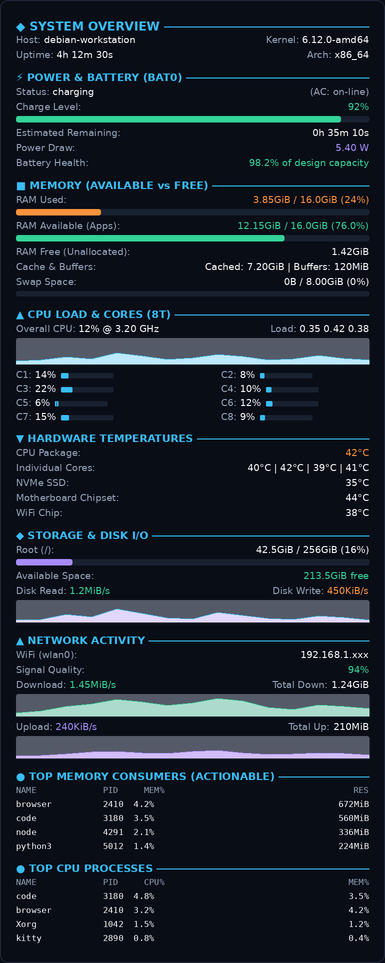

# Advanced Detailed Conky System Monitor

A modern, privacy-first, secure system monitor engineered specifically for Linux desktop workstations and laptops. It combines precision metrics (such as the vital **RAM Available vs. Free** distinction, live battery wattage & health diagnostics, per-core CPU load, and module-named thermal sensors) with an obsidian dark-glass aesthetic.



---

## 🔒 Security & Privacy Architecture

This project is built from the ground up to respect user security and data privacy:

| Principle | Implementation Detail |
| :--- | :--- |
| **100% Offline & Private** | Zero outbound network calls, zero telemetry, zero analytics tracking, and zero external script downloads. Everything runs locally on your machine. |
| **Unprivileged Execution** | Operates strictly in user-space (`$HOME/.config/`). **No `sudo` or root privileges are required** for installation, monitoring, or autostart. |
| **POSIX & Shell Safety** | All scripts use strict shell error handling (`set -euo pipefail`), quoted variables, zero unsafe `eval` constructs, and clean signal handling. |
| **Safe Sysfs & Procfs Access** | Only reads public, non-sensitive kernel statistics (`/proc/meminfo`, `/proc/loadavg`, `/sys/class/power_supply`, `/sys/class/hwmon`). |
| **Clean Uninstall Guarantee** | The `--uninstall` command completely purges all autostart hooks and generated files with zero residual system modifications. |

---

## 🚀 Unified Management Script (`Setup-Detailed-Conky.sh`)

All lifecycle commands (installation, removal, process management, diagnostics, and autostart) are managed through a single script: [`Setup-Detailed-Conky.sh`](Setup-Detailed-Conky.sh).

### Quick Usage Overview

```bash
# 1. Install & enable permanent autostart on every boot/login
./Setup-Detailed-Conky.sh --install

# 2. Check running state, memory consumption, autostart, & hardware
./Setup-Detailed-Conky.sh --status

# 3. Scale fonts & take full vertical height (options: normal, large, xlarge)
./Setup-Detailed-Conky.sh --zoom large      # Full 1080p vertical height (default)
./Setup-Detailed-Conky.sh --zoom normal     # Compact 330px layout
./Setup-Detailed-Conky.sh --zoom xlarge     # Extra large for 1440p / 4K displays

# 4. Stop or restart Conky
./Setup-Detailed-Conky.sh --restart
./Setup-Detailed-Conky.sh --stop

# 4. Audit system sensors and device names
./Setup-Detailed-Conky.sh --detect

# 5. Cleanly uninstall everything
./Setup-Detailed-Conky.sh --uninstall
```

### Supported Parameters Reference

| Parameter | Alias | Function |
| :--- | :--- | :--- |
| `--install` | `-i` | Audits hardware sensors, generates a tailored `conky.conf`, installs to `~/.config/conky/`, registers desktop autostart, and launches Conky immediately. |
| `--uninstall` | `-u` | Stops running Conky processes, deletes `~/.config/autostart/conky.desktop`, removes the MX Linux startup hook, and cleans user configurations. |
| `--status` | `-s` | Displays live process state (PID, Memory RSS), autostart status, active configuration path, and detected hardware sensors. |
| `--start` | | Starts Conky in background daemon mode. |
| `--stop` | | Gracefully terminates all active Conky instances. |
| `--restart` | `-r` | Stops any existing Conky instance and launches a fresh one with the active configuration. |
| `--zoom [LEVEL]` | `-z` | Scales fonts, gauges, and dimensions. Options: `large` (default, full 1080p height 385px × 1020px), `normal` (compact 330px), `xlarge` (440px for 1440p/4K). Remembers preference in `~/.config/conky/zoom_profile`. |
| `--detect` | `-d` | Scans and prints live `/sys/class/` hardware paths, battery state, thermal modules, and network interfaces. |
| `--help` | `-h` | Prints the interactive command-line manual and examples. |

---

## 📊 Monitored Metrics & Architecture

### 1. Memory Architecture: Available vs. Free vs. Used

> [!IMPORTANT]
> **Why "Available" RAM is the True Usable Metric:**
> Linux utilizes spare, unallocated RAM for page cache and file buffering (`Cached` + `Buffers`) to accelerate disk access. Traditional `Free` memory only measures idle, untouched memory addresses.
> 
> **Available RAM** (`MemAvailable` in `/proc/meminfo`) estimates the true volume of memory that can immediately be provided to user applications without forcing memory thrashing or swap disk paging.

This monitor presents all four layers simultaneously:
- **RAM Used**: `${mem} / ${memmax} (${memperc}%)` with an amber capacity track.
- **RAM Available (Apps)**: `${memavail} / ${memmax}` with exact real-time percentage calculated via `/proc/meminfo` and an emerald-green gauge.
- **RAM Free (Raw Unallocated)**: Untouched idle memory (`${memfree}`).
- **Cache & Buffers**: Exact reclaimable kernel cache (`${cached}`) and buffers (`${buffers}`).
- **Swap Utilization**: Real-time swap disk memory `${swap} / ${swapmax} (${swapperc}%)`.

---

### 2. Battery & Power Diagnostics

Automatically detects system battery devices (e.g. `BAT0` or `BAT1`) and AC adapters (`AC` or `ACAD`):
- **Charge Status**: Displays `charging`, `discharging`, `full`, or `not charging` alongside AC adapter connection state (`ACAD`).
- **Percentage & Visual Bar**: Real-time capacity level with emerald gradient bar.
- **Estimated Time Remaining**: Countdown to full charge or depletion (`${battery_time BAT0}`).
- **Live Power Draw (Watts)**: Computed from `current_now` and `voltage_now` to eliminate kernel warning messages on modern systems:
  $$\text{Power (Watts)} = \frac{\text{current\_now } (\mu\text{A}) \times \text{voltage\_now } (\mu\text{V})}{10^{12}}$$
- **Battery Health Diagnostics**: Compares current full charge retention against the factory design capacity (`${execi 60 awk ...}`):
  $$\text{Health Retention \%} = \frac{\text{charge\_full}}{\text{charge\_full\_design}} \times 100$$

---

### 3. CPU, Multi-threading & Hardware Thermals

- **Multi-thread Core Bars**: Automatically checks core count (`nproc`) and renders dual-column gauges for all logical threads (e.g. `C1` through `C8`).
- **Overall Load**: CPU utilization percentage, dynamic clock speed (`${freq_g} GHz`), and 1m/5m/15m system load averages.
- **Driver-Named Thermal Sensors**:
  Rather than relying on volatile numeric indices (`hwmon0`, `hwmon1`) that swap after kernel updates or reboots, this configuration uses **kernel module names**:
  - **CPU Package**: `${hwmon coretemp temp 1}°C`
  - **Individual Cores 0–3**: `${hwmon coretemp temp 2}` through `${hwmon coretemp temp 5}`
  - **NVMe SSD Storage**: `${hwmon nvme temp 1}°C`
  - **Motherboard Chipset**: `${hwmon pch_cannonlake temp 1}°C`
  - **Wi-Fi Chipset**: `${hwmon ath10k_hwmon temp 1}°C`

---

### 4. Storage & Disk Throughput

- **Root Volume (`/`)**: Displays used space, total capacity, usage percentage, free space, and disk progress bar.
- **Disk I/O**: Real-time read throughput (`${diskio_read}`) and write throughput (`${diskio_write}`) accompanied by a live disk activity history graph.

---

### 5. Network Activity

- **Dynamic Adapter Selection**: Detects wireless (`wlan0`) or wired (`eth0`) interfaces.
- **IP & Signal**: Displays assigned IPv4 address and Wi-Fi link quality (`${wireless_link_qual_perc}`).
- **Bandwidth Speeds & Graphs**: Separate real-time download and upload rate monitors with visual history graphs.
- **Session Totals**: Cumulative downloaded (`${totaldown}`) and uploaded (`${totalup}`) data transfer for the active session.

---

### 6. Actionable Process Tables

Configured in fixed monospace font (`DejaVu Sans Mono`) with aligned columns:
- **Top Memory Consumers**: Displays `NAME`, `PID`, `MEM%`, and Resident Set Size (`RES`) so you can identify memory leaks or browser tabs taking up RAM.
- **Top CPU Consumers**: Displays `NAME`, `PID`, `CPU%`, and `MEM%`.

---

---

## 🔍 Display Scaling & Zoom Profiles (`--zoom`)

Conky dynamically scales its window geometry, font sizes, gauge thicknesses, and dual-column CPU layout based on your screen resolution and visual preference:

| Profile | Dimensions | Base Font | Headers Font | Target Displays |
| :--- | :--- | :--- | :--- | :--- |
| **`normal`** | 330px × 840px | DejaVu Sans 8pt | Bold 9pt / 10pt | Compact floating monitor |
| **`large`** *(Default)* | 385px × 1020px | DejaVu Sans 9.5pt | Bold 10.5pt / 12pt | **Full vertical height on 1080p (FHD)** |
| **`xlarge`** | 440px × 1180px | DejaVu Sans 11pt | Bold 12pt / 13.5pt | High-DPI, 1440p (QHD), and 4K (UHD) |

Your active profile preference is saved to `~/.config/conky/zoom_profile` and automatically preserved across reboots and `--install` / `--restart` operations.

## 🔄 Permanent Autostart Mechanism

When you run `./Setup-Detailed-Conky.sh --install`, it registers two autostart hooks to ensure 100% compatibility across desktop environments:

1. **Universal Desktop Autostart (`~/.config/autostart/conky.desktop`)**:
   Standard XDG specification recognized by XFCE, GNOME, KDE Plasma, Cinnamon, MATE, LXQt, and LightDM sessions.
2. **MX Linux Compatibility Hook (`~/.conky/conky-startup.sh`)**:
   MX Linux includes a desktop script that prioritizes `~/.conky/conky-startup.sh` if present, bypassing default theme overwrites.
3. **Startup Delay**:
   Includes a 3-second initialization delay so window managers, panels (like Tint2 or XFCE Panel), and wallpaper setters (Nitrogen / xfdesktop) settle before Conky draws, preventing window layering glitches.

---

## 🛠 File Layout

```text
Setup-Detailed-Conkey/
├── Setup-Detailed-Conky.sh    # Self-contained master manager (--install, --uninstall, --status, etc.)
├── setup-detailed-conky.sh    # Compatibility symlink for uniform module execution
├── conky.conf                 # Active Lua Conky desktop configuration template
├── conky-preview.png          # Desktop visual layout preview (100% sanitized dummy data)
└── README.md                  # Complete technical documentation
```
