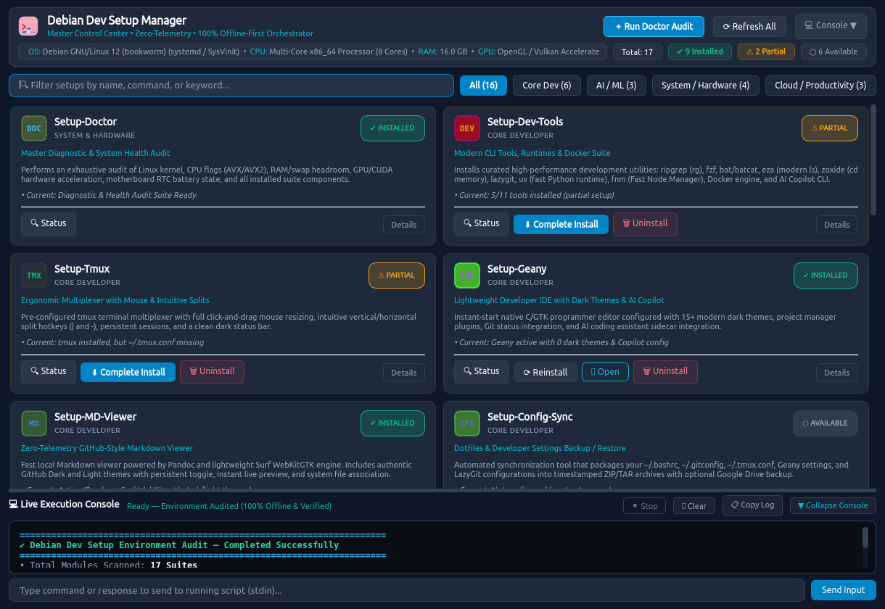

# Setup-GUI-Manager — Visual Control Center & Setup Orchestrator

Part of the **[Debian Dev Suite](https://github.com/)**.

**Debian Dev Suite Manager** is a modern, high-performance, native graphical control center for managing your complete Debian/MX Linux development environment. It provides a visual dashboard to audit installed components, trigger one-click installations or clean uninstalls, watch live shell commands stream in an embedded terminal, and inspect detailed diagnostic health reports.



---

## Key Features

### 1. Visual Installation & Health Audit
- **Real-Time Module Discovery**: Scans all 16 Debian-Dev-Suite modules asynchronously and categorizes each into:
  - 🟢 **INSTALLED**: Active, configured, and verified.
  - 🟡 **PARTIAL**: Installed but requires configuration (e.g. dotfiles, stopped service).
  - ⚪ **AVAILABLE**: Not yet installed, ready for 1-click installation.
- **System Specs Summary**: Displays real-time OS distribution, kernel version, CPU architecture & vector instructions, RAM/swap headroom, active init system (systemd or SysVinit / antiX / MX Linux), and GPU/CUDA acceleration.
- **Search & Category Filters**: Instantly filter modules by name, keyword, or category (*Core Developer*, *AI & Machine Learning*, *System & Hardware*, *Cloud & Productivity*).

### 2. Individual Module Install & Clean Uninstall
- **One-Click Actions**: Every module card provides dedicated **Install**, **Reinstall**, and **Uninstall** buttons.
- **Safe Confirmation Dialogs**: Prevents accidental removals with clear command previews.
- **Privilege Escalation**: Automatically leverages `pkexec` or `sudo` for operations requiring system package installations (`apt`) or kernel modifications.

### 3. Integrated Live Terminal Console
- **Real-Time Output Streaming**: Subprocesses stream stdout and stderr line-by-line as commands execute—no frozen windows or waiting until completion.
- **Full ANSI Color Support**: Translates terminal escape codes into rich HTML colors, rendering script checkmarks (✔), warnings (⚠), and section banners natively.
- **Interactive Stdin Input Bar**: Allows sending input directly to running commands (e.g. typing `y`, choices, or confirmations).
- **Process Controls**: Dedicated **Stop (⏹)**, **Clear (🧹)**, and **Copy Log (📋)** buttons.

### 4. Direct App & Service Launchers
- Quick-open buttons for installed graphical applications and local web services:
  - 📝 **Geany IDE**
  - 📖 **Markdown Viewer**
  - 💬 **LibreChat Web UI** (`http://127.0.0.1:3080`)
  - 🐙 **Localhost Forgejo** (`http://127.0.0.1:3000`)
  - ☀️ **Brightness Controller GUI**
  - 🇮🇳 **Easy Hindi Typing Web App** (`http://127.0.0.1:45678`)
  - 📦 **VirtualBox VM Manager**
  - ☁️ **Google Drive Folder** (`~/GoogleDrive`)

---

## Quick Start

### 1. Launch from Terminal (Rootless & Automated Isolation)
You can launch the GUI Manager instantly from the repository root:
```bash
./manager.sh
```
Or from the module directory:
```bash
cd Setup-GUI-Manager
./setup-manager.sh
```
> **Self-Managing Shared Virtual Environment (`.venv`)**:
> On first run, `setup-manager.sh` automatically creates a shared Python virtual environment at the repository root (`.venv`), links system packages with 0s overhead, and verifies or installs PySide6 rootlessly. This virtual environment is shared across all Python tools in the project (including `Setup-GUI-Manager` and `Setup-Brightness`). You do **not** need to manually activate a venv or run pip.

### 2. Non-Root Diagnostic Health Check
```bash
./setup-manager.sh --status
```

### 3. Explicitly Prepare Virtual Environment (Optional)
```bash
./setup-manager.sh --create-venv
```

### 4. Install System Menu Shortcut (Optional)
To register the GUI Manager in your system's application menu (XFCE, KDE, GNOME, etc.) and create a global `debian-dev-manager` command:
```bash
sudo ./setup-manager.sh --install
```

### 5. Clean Uninstallation of Shortcut
```bash
sudo ./setup-manager.sh --uninstall
```

---

## Command-Line Usage

```text
Debian Dev Suite GUI Manager — Command Line Interface

Usage:
  ./setup-manager.sh [OPTION]

Options:
  (no arguments), --launch, -l   Launch Debian Dev Suite Manager GUI (auto-initializes .venv)
  --status, -s                   Check GUI dependencies, Python bindings & desktop integration
  --create-venv, --venv          Explicitly create or refresh isolated Python virtual environment (.venv)
  --install, -i                  Install system desktop shortcut, icon & /usr/local/bin/debian-dev-manager
  --uninstall, -u                Remove desktop shortcuts, icon & global symlinks
  --help, -h                     Display this help message
```

---

## Architectural & Privacy Guarantees

- **100% Offline & Zero Telemetry**: Absolutely zero cloud analytics, tracking beacons, or network phone-home calls.
- **Dual Init System Compatible**: Works seamlessly under both standard Debian `systemd` and SysVinit / OpenRC (antiX / MX Linux lightweight modes).
- **Zero Hardcoding**: Dynamically resolves user home directories, script paths, and usernames using POSIX standards.
- **Root Separation**: Running the GUI or inspecting module statuses never requires `sudo` privileges.

---

## Third-Party Open Source Attribution

Debian Dev Suite Manager acts as an integration and orchestration interface, utilizing the following open source technologies:
- **PySide6**: Official Qt for Python bindings developed by [The Qt Company](https://www.qt.io/) (LGPLv3).
- **Python 3**: Python Software Foundation License.
